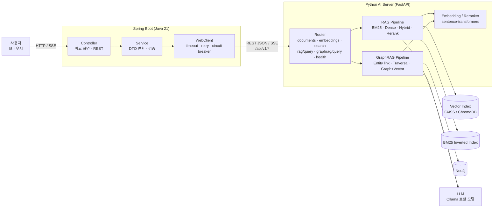
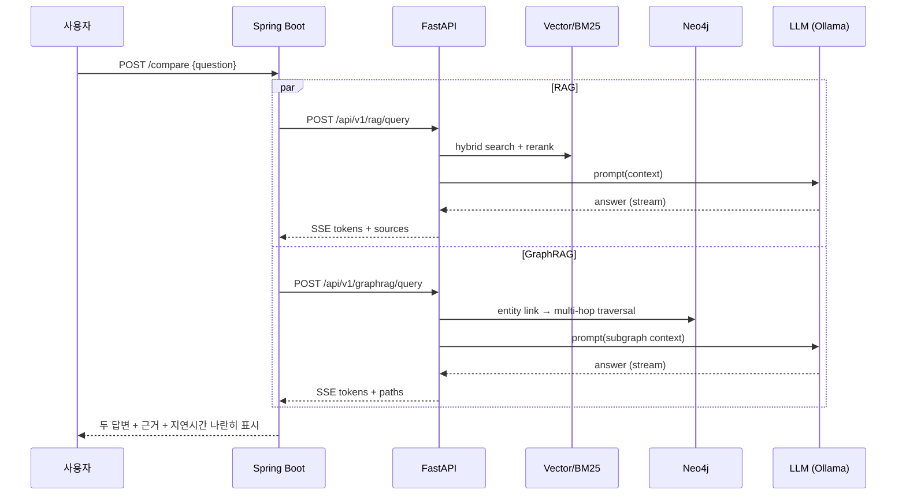

# 아키텍처 & 규약

## 1. 최종 디렉터리 구조

기존 강의 트랙(`part1`~`part4`, `common`)은 **그대로 두고**, 새 AI Lab 트랙을 다른 이름의 최상위 폴더로 추가한다.

```
graphRAG_learning/
├── README.md                     # (기존) + 문서 링크 섹션 추가
├── LEARNING.md                   # (기존) 강의 트랙 학습 목차
├── 커리큘럼.pdf                   # (기존)
│
├── docs/                         # ★ AI Lab 문서
│   ├── PROJECT_PLAN.md  REPOSITORY_ANALYSIS.md  LEARNING_ROADMAP.md
│   ├── ARCHITECTURE.md  ENVIRONMENT.md  PROGRESS.md
│
├── requirements/                 # ★ 단계별 의존성 (AI Lab 환경용)
│   ├── base.txt  part1.txt  part2.txt  part3.txt  part4.txt  part5.txt  part6.txt  dev.txt
│
├── ── 기존 강의 트랙 (변경 없음) ──────────────────────────────
├── common/                       # 강의 트랙 공용 uv 환경
├── part1/                        # Neo4j 기초                (Python 3.14 .venv)
├── part2/{txt2kg,csv2kg,pdf2kg,law2kg,retail2kg,medical2kg}
├── part3/{vectorsearch,text2cypher,reasoning,vectorcypher,vectorcypher_qdrant,
│          community_search,toolsretriever,evaluation,learning}
├── part4/{create_agent,streamlit,graphrag_tool_agent,graphrag_text2cypher_agent,final_chatbot}
│
├── ── 새 AI Lab 트랙 (Part 1 부터 순차 생성) ─────────────────────
├── part1_ai_fundamentals/
│   ├── tokenizer/  embedding/  word2vec/  pytorch/  transformer/
├── part2_llm/
│   ├── next_token/  backprop/  optimizer/  overfitting/  small_lm/
│   ├── generation/  pretrained/  instruction_tuning/  lora/  qlora/
├── part3_rag/
│   ├── document_loader/  chunking/  dense_retrieval/  sparse_retrieval/
│   ├── hybrid_search/  reranking/  evaluation/  generation/
├── part4_graphrag/
│   ├── knowledge_graph/  entity_extraction/  relationship_extraction/
│   ├── graph_traversal/  graph_retrieval/  evaluation/
├── part5_finetuning/
│   ├── embedding/  reranker/  llm_lora/
├── part6_ai_service/
│   ├── python_ai_server/         # FastAPI (app/, tests/, Dockerfile)
│   ├── spring_boot_server/       # Gradle, Java 21 (src/main, src/test, Dockerfile)
│   └── docker-compose.yml
│
├── datasets/                     # 데이터 설명·다운로드 스크립트·작은 샘플만 커밋 (원본 대용량은 gitignore)
├── experiments/                  # ★ 실험 기록 (포트폴리오)
└── tests/                        # pytest — 각 Part 폴더 구조를 그대로 미러링
```

> 각 하위 폴더(예: `tokenizer/`)는 실습 단위 폴더를 가진다: `part1_ai_fundamentals/tokenizer/p1_02_bpe/`. 폴더 이름의 `p1_02` 는 [LEARNING_ROADMAP](LEARNING_ROADMAP.md) 의 실습 ID 와 같다.

## 2. 명칭 충돌 해결: 기존 `partN` vs 신규 `partN_xxx`

**문제**: 기존 `part1` 은 "Neo4j 기초", 새 로드맵의 Part 1 은 "AI/딥러닝 기초"로 내용이 전혀 다르다. 또 사용자는 `C:\gitRepo\graphRAG_learning\part1\.venv` 를 실사용 중이다.

| 대안 | 장점 | 단점 | 판정 |
|---|---|---|---|
| A. 기존 `part1~4` 를 `course_graphrag/` 로 이동 | 이름이 깔끔 | 사용자의 `part1\.venv` 경로, 문서 링크, 각 `uv.lock` 경로가 깨짐. "기존 소스 대규모 변경 금지" 위반 | ❌ |
| B. 기존 `part1` 안에 새 내용 합치기 | 폴더 수 적음 | 주제 혼합, Python 3.14 환경에 torch 등이 섞임 | ❌ |
| **C. 새 트랙을 `part1_ai_fundamentals` 등 접미사 이름으로 추가** | 기존 무변경, 경로·환경 유지, 이름만 봐도 구분됨 | 최상위 폴더 수 증가 | ✅ **채택** |

**규칙**
- `partN/` = **강의 트랙**(GraphRAG 강의, 라이브러리 사용 중심). 수정하지 않고 참조만 한다.
- `partN_<주제>/` = **AI Lab 트랙**(원리 직접 구현 + 비교). 새 코드는 여기에만 쓴다.
- 문서에서 모호할 때는 "강의 part3" / "Lab Part 3" 처럼 접두어를 붙인다.
- Lab Part 4 는 강의 `part2`·`part3` 를 상대 경로로 참조하는 비교 실험으로 구성한다. 강의 코드를 복사해 오지 않는다.

## 3. 서비스 아키텍처 (Part 6 최종 형태)



### 3.1 요청 흐름 (RAG vs GraphRAG 비교 화면)



### 3.2 API 초안 (Part 6 에서 확정)

| Method | Path | 설명 |
|---|---|---|
| GET | `/api/v1/health` | 상태, 모델 로드 여부, Neo4j·LLM 연결 |
| POST | `/api/v1/documents` | 문서 업로드 → 로딩·청킹·인덱싱 |
| GET | `/api/v1/documents/{id}` | 문서·청크 메타데이터 |
| POST | `/api/v1/embeddings` | 텍스트 → 벡터 |
| POST | `/api/v1/search` | `{query, method: bm25\|dense\|hybrid, rerank, top_k}` |
| POST | `/api/v1/rag/query` | 검색 + 생성, `stream=true` 이면 SSE |
| POST | `/api/v1/graphrag/query` | 그래프 검색 + 생성, SSE 지원 |

공통 응답에는 `latency_ms`, `sources`(청크 ID·출처) 또는 `paths`(그래프 경로)를 포함한다. 오류는 `{code, message, detail}` 형식으로 통일하고 Spring Boot 에서 도메인 예외로 변환한다.

- 처음엔 **REST + SSE**. gRPC 는 P6-12 확장 과제.
- 유료 API 없이 동작하는 것이 기본값. (선택) 기존 강의 트랙처럼 OpenAI/Claude 를 쓰는 어댑터는 설정으로만 켠다.

## 4. 실습 코드 규약 (starter / solution / test)

### 4.1 실습 폴더 구성

```
part3_rag/sparse_retrieval/p3_07_bm25/
├── README.md          # 12개 항목 (아래 4.3)
├── starter.py         # TODO 가 있는 학습자용 파일
├── solution.py        # 완성본 (정답)
└── data/              # (필요 시) 아주 작은 샘플만
tests/part3_rag/sparse_retrieval/test_p3_07_bm25.py
```

- `starter.py` 와 `solution.py` 는 **같은 공개 함수·클래스 시그니처**를 가진다. starter 의 TODO 는 `raise NotImplementedError("TODO: ...")` 로 표시한다.
- 실행 진입점은 `if __name__ == "__main__":` 블록. 예상 출력은 README 에 적는다.
- 난이도는 README 맨 위와 TODO 주석에 `Level 1/2/3` 으로 표시한다.
- 실습 하나의 흐름: **개념 → 수학 원리 → 데이터 흐름 → 코드 구조 → 구현할 부분 → 실행법 → 예상 출력 → 결과 해석 → 과제 → 정답**.

### 4.2 테스트 규약
- 테스트는 루트 `tests/` 아래에 Part 폴더 구조를 미러링한다.
- 공용 `tests/conftest.py` 가 `--impl` 옵션(`solution` 기본, `starter` 선택)을 받아 해당 파일을 경로로 import 한다.
  - `pytest tests/part3_rag` → solution 기준, **항상 통과해야 함**
  - `pytest tests/part3_rag --impl starter` → 학습자가 TODO 를 채우면 통과
- 수치 비교는 허용 오차를 둔다 (`torch.testing.assert_close`, `pytest.approx`).
- 마커: `@pytest.mark.gpu`(CUDA 필요), `@pytest.mark.slow`(1분 이상), `@pytest.mark.network`(모델 다운로드 필요). 기본 실행은 `-m "not gpu and not slow and not network"`.
- 라이브러리 비교 테스트(예: 직접 BM25 vs `rank-bm25`)는 "같은 설정에서 같은 결과"를 검증한다.

### 4.3 실습 README 12개 항목 (템플릿)

```markdown
# P3-07 BM25 직접 구현  (Level 2)
1. 목표
2. 선수지식
3. 핵심 개념
4. 내부 원리
5. 수식 / 그림
6. 실행법
7. TODO 목록
8. 예상 결과
9. 자주 나는 오류
10. 과제
11. 체크리스트
12. 다음 단계 연결
```

### 4.4 실험 기록 규약
- 학습·벤치마크를 돌리면 `experiments/` 에 기록한다. 형식: [experiments/README.md](../experiments/README.md)
- 결과 CSV·그림은 `experiments/<날짜>_<실습ID>_<요약>/` 에 둔다. 모델 체크포인트는 커밋하지 않는다.

### 4.5 기타 규약
- 시크릿은 `.env` 에만 (기존 저장소 규칙과 동일).
- 큰 파일(모델, 원본 데이터, 인덱스)은 커밋하지 않는다. Part 1 시작 시 `.gitignore` 에 `datasets/raw/`, `experiments/**/checkpoints/`, `*.faiss`, `*.safetensors` 등을 추가한다.
- 공용 유틸(seed 고정, 시간·GPU 메모리 측정, 실험 기록 저장)은 처음 필요해지는 시점에 `labkit/` 같은 작은 패키지로 묶는다. 미리 만들지 않는다.
- 코드 주석과 문서는 한국어, 식별자는 영어.

## 5. 용어 정리 (혼동 방지)

| 용어 | 이 프로젝트에서의 의미 |
|---|---|
| Hybrid Search | **Sparse(BM25) + Dense(벡터) 결과 융합** (RRF, Weighted). 강의 `part3/learning/step3_hybrid_retrieval.py` 의 "벡터 + 그래프 확장"과 다름 |
| Graph + Vector 검색 | 벡터로 시드 노드를 찾고 그래프로 확장 (강의의 VectorCypher 패턴) |
| GraphRAG | 그래프 구조(개체·관계·경로)를 검색 컨텍스트로 쓰는 RAG |
| 직접 구현 | NumPy/PyTorch/표준 라이브러리로 알고리즘을 작성한 것 |
| 비교군 | 같은 기능의 기존 라이브러리 구현 또는 강의 트랙 코드 |
