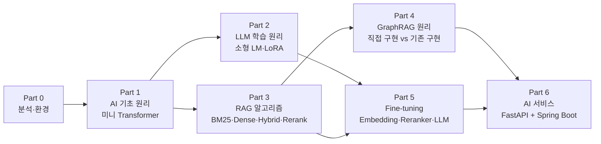

# 학습 로드맵 (Part 0 ~ 6)

> 기준: 주당 8~10시간, 총 약 30주. 일정은 **목표치**이며, 매주 [PROGRESS.md 주간 점검](PROGRESS.md#주간-점검-템플릿)에서 조정한다.
> 실습 ID(`P1-02` 등)는 [PROGRESS.md](PROGRESS.md) 와 [`experiments/`](../experiments/README.md) 기록에서 공통으로 쓴다.

## 1. 전체 흐름

- Part 3 은 Part 2 와 **병행 가능**하다(의존: Part 1 의 임베딩·코사인 유사도). 지치면 Part 3 를 먼저 해도 된다.
- 각 Part 의 마지막 실습은 **마일스톤**(★)이며, 결과를 `experiments/` 에 반드시 기록한다.

## 2. 단계별 실습 목록

난이도: **L1** 따라 하며 이해 / **L2** 핵심 로직 직접 구현 / **L3** 설계·비교·분석까지.
"비교군"은 같은 기능을 하는 라이브러리 구현 — 직접 구현 결과와 **수치로** 맞춰 본다.

### Part 0. 저장소 분석 & 환경 (1주)
| ID | 실습 | 난이도 | 결과물 |
|---|---|---|---|
| P0-01 | 기존 저장소 분석 문서 검토 | L1 | `docs/*` 확인 |
| P0-02 | AI Lab 전용 uv 환경(Python 3.12) 구축, `torch.cuda.is_available()` 확인 | L1 | `experiments/` 에 GPU 확인 로그 |
| P0-03 | Neo4j(Desktop/Docker), Ollama 로컬 설치 확인 | L1 | 접속 확인 |

### Part 1. AI/딥러닝 내부 원리 (`part1_ai_fundamentals/`, 5주)
| ID | 폴더 | 실습 | 난이도 | 비교군 |
|---|---|---|---|---|
| P1-01 | tokenizer | 문자·단어 토크나이저, vocab, encode/decode | L1 | — |
| P1-02 | tokenizer | **BPE 학습·인코딩·디코딩 직접 구현** | L2 | HF `tokenizers` BPE, `tiktoken` |
| P1-03 | embedding | one-hot vs embedding lookup, 코사인 유사도, 차원의 의미 | L1 | `nn.Embedding` |
| P1-04 | word2vec | Skip-gram (full softmax, NumPy) | L2 | — |
| P1-05 | word2vec | CBOW | L2 | — |
| P1-06 | word2vec | Negative Sampling + subsampling, 유사 단어·유추 평가 | L3 | `gensim`(선택) |
| P1-07 | pytorch | Tensor, autograd, `nn.Module`, 학습 루프, GPU 이동 | L1 | — |
| P1-08 | pytorch | Word2Vec 을 PyTorch 로 재구현, CPU vs GPU 시간 측정 | L2 | P1-06 결과 |
| P1-09 | transformer | Scaled dot-product attention + causal/padding mask | L2 | `F.scaled_dot_product_attention` |
| P1-10 | transformer | Multi-Head Attention | L2 | `nn.MultiheadAttention` |
| P1-11 | transformer | Positional Encoding (sinusoidal, 선택: learned/RoPE) | L2 | — |
| P1-12 | transformer | FFN + Residual + LayerNorm (Pre-LN) 블록 | L2 | `nn.TransformerEncoderLayer` |
| P1-13 ★ | transformer | **미니 GPT 조립 + 문자 단위 언어모델 학습** (≈1~10M 파라미터) | L3 | — |

### Part 2. LLM 학습 원리 (`part2_llm/`, 4주)
| ID | 폴더 | 실습 | 난이도 | 비교군 |
|---|---|---|---|---|
| P2-01 | next_token | Next token prediction, Cross-Entropy, perplexity 수식 구현 | L1 | `F.cross_entropy` |
| P2-02 | backprop | 스칼라 autograd 엔진 직접 구현, 수동 미분 | L2 | `torch.autograd` |
| P2-03 | optimizer | SGD / Momentum / Adam / AdamW 직접 구현, LR 스케줄(warmup+cosine) | L2 | `torch.optim` |
| P2-04 | overfitting | train/val 곡선, dropout, weight decay, early stopping | L2 | — |
| P2-05 ★ | small_lm | **소형 LM 사전학습** (P1-13 확장, BPE 토크나이저, 10~30M 파라미터) | L3 | — |
| P2-06 | generation | greedy / temperature / top-k / top-p, KV cache 개념 | L2 | HF `generate()` |
| P2-07 | pretrained | 사전학습 모델 로드(Qwen 0.5B 등), perplexity 비교, pre-training vs fine-tuning | L2 | — |
| P2-08 | instruction_tuning | chat template, 프롬프트 부분 loss masking, 소규모 SFT | L2 | `trl` SFTTrainer |
| P2-09 | lora | **LoRA 를 `nn.Linear` 래퍼로 직접 구현** | L3 | `peft` LoRA |
| P2-10 | qlora | 4bit NF4 로드, 메모리 측정, QLoRA 구조 이해 | L2 | `bitsandbytes` |

### Part 3. RAG 내부 알고리즘 (`part3_rag/`, 5주)
| ID | 폴더 | 실습 | 난이도 | 비교군 |
|---|---|---|---|---|
| P3-01 | document_loader | txt/md/pdf 로더, 메타데이터(출처·페이지) 보존 | L1 | 기존 `part2/pdf2kg` (PyMuPDF/docling) |
| P3-02 | chunking | 고정 길이 / overlap / 재귀 / 문장 단위 청킹 | L2 | `langchain-text-splitters` |
| P3-03 | evaluation | **평가셋(질문 → 정답 청크 qrels) 구축** | L1 | — |
| P3-04 | dense_retrieval | 임베딩 + NumPy brute-force 코사인 top-k | L1 | — |
| P3-05 | dense_retrieval | FAISS Flat / IVF / HNSW, recall vs latency | L2 | 기존 `part3/vectorsearch`(Neo4j 벡터 인덱스) |
| P3-06 | sparse_retrieval | Inverted Index + TF-IDF 직접 구현 | L2 | `scikit-learn` TfidfVectorizer |
| P3-07 | sparse_retrieval | **BM25 직접 구현** (k1, b), 한국어 토큰화 영향 | L2 | `rank-bm25`, `bm25s` |
| P3-08 | hybrid_search | **RRF, Weighted fusion(min-max / z-score) 직접 구현** | L2 | — |
| P3-09 | hybrid_search | **프레임워크 하이브리드 비교** (§5) | L3 | LangChain, LlamaIndex, Haystack, neo4j-graphrag |
| P3-10 | reranking | Cross-Encoder 재순위, top-N 후보 수에 따른 품질·지연 | L2 | `sentence-transformers` CrossEncoder |
| P3-11 | evaluation | **Precision/Recall/HitRate@K, MRR, NDCG 직접 구현**, Latency(p50/p95) | L2 | `ranx`(선택) |
| P3-12 ★ | evaluation | **BM25 vs Dense vs Hybrid vs Hybrid+Rerank 동일 데이터셋 비교**, CSV + 그래프 | L3 | — |
| P3-13 | dense_retrieval | (선택) ChromaDB 로 같은 실험, FAISS 와 차이 | L1 | `chromadb` |
| P3-14 | generation | 로컬 LLM 으로 답변 생성, (선택) RAGAS 와 IR 지표 비교 | L2 | 기존 `part3/evaluation/ragas` |

### Part 4. GraphRAG 내부 원리 (`part4_graphrag/`, 4주)
> 기존 `part2/*2kg`, `part3/*` 를 **다시 만들지 않는다.** 직접 구현한 것과 기존 라이브러리 구현을 같은 입력으로 비교한다.

| ID | 폴더 | 실습 | 난이도 | 비교군 (기존 저장소) |
|---|---|---|---|---|
| P4-01 | knowledge_graph | 인접 리스트·트리플 저장소 직접 구현, 직렬화 | L1 | `networkx`, Neo4j (`part1`) |
| P4-02 | entity_extraction | 사전·규칙 기반 개체 추출 | L2 | `part2/txt2kg` (OpenAI LLM 추출), 로컬 LLM 추출 |
| P4-03 | relationship_extraction | 패턴 기반 관계 추출, 스키마 제약 검증 | L2 | `part2/medical2kg` (스키마 + LLM) |
| P4-04 | entity_extraction | 개체 정규화·병합(entity resolution) | L2 | — |
| P4-05 | graph_traversal | **BFS/DFS 직접 구현** | L1 | Cypher 가변 길이 패턴 |
| P4-06 | graph_traversal | **최단경로(BFS/Dijkstra) 직접 구현** | L2 | Cypher `shortestPath`, GDS |
| P4-07 | graph_traversal | 멀티홉 질의 (k-hop, 경로 제약) | L2 | `part3/reasoning` |
| P4-08 | graph_retrieval | **Graph + Vector 검색 직접 구현** (벡터로 시드 개체 → 그래프 확장 → 컨텍스트) | L3 | `part3/vectorcypher`, `vectorcypher_qdrant` |
| P4-09 | graph_retrieval | (선택) 로컬 LLM Text2Cypher | L2 | `part3/text2cypher` |
| P4-10 ★ | evaluation | **멀티홉 질문셋으로 Vector RAG vs GraphRAG 정량 평가** | L3 | `part3/evaluation/*` |

### Part 5. Fine-tuning (`part5_finetuning/`, 4주)
> 모든 실습은 **학습 전 baseline → 학습 → 같은 테스트셋 재평가** 순서. 개선을 가정하지 않으며, 나빠지면 그 결과와 원인 분석을 그대로 기록한다. GPU 최대 메모리(`torch.cuda.max_memory_allocated`)와 학습 시간을 반드시 기록.

| ID | 폴더 | 실습 | 난이도 |
|---|---|---|---|
| P5-01 | embedding | Part 3 평가셋으로 baseline 측정, train/test 분리(누수 방지) | L1 |
| P5-02 | embedding | MultipleNegativesRankingLoss 학습 | L2 |
| P5-03 | embedding | Triplet loss + hard negative mining (BM25/Dense) | L3 |
| P5-04 | reranker | Cross-Encoder Reranker 미세조정 | L3 |
| P5-05 | llm_lora | 0.5B~1.5B LoRA (도메인 QA / 포맷 학습) | L2 |
| P5-06 | llm_lora | 3B~7B QLoRA (메모리 한계 실측) | L3 |
| P5-07 ★ | (공통) | 학습 전후 종합 리포트 (품질·메모리·시간) | L3 |

### Part 6. AI 서비스 (`part6_ai_service/`, 5주)
| ID | 폴더 | 실습 | 난이도 |
|---|---|---|---|
| P6-01 | python_ai_server | FastAPI 구조, 설정, `/api/v1/health` | L1 |
| P6-02 | python_ai_server | `/api/v1/documents`, `/api/v1/embeddings` | L2 |
| P6-03 | python_ai_server | `/api/v1/search` (bm25/dense/hybrid/rerank 선택 파라미터) | L2 |
| P6-04 | python_ai_server | `/api/v1/rag/query`, `/api/v1/graphrag/query` | L2 |
| P6-05 | python_ai_server | 스트리밍 응답 (SSE) | L2 |
| P6-06 | python_ai_server | pytest (TestClient), 예외 처리, 구조화 로깅 | L2 |
| P6-07 | spring_boot_server | WebClient + DTO, Python 서버 호출 | L2 |
| P6-08 | spring_boot_server | SSE 프록시 (`Flux<ServerSentEvent>`) | L3 |
| P6-09 | spring_boot_server | 타임아웃·재시도·서킷브레이커(Resilience4j), 전역 예외 처리, 로깅 | L3 |
| P6-10 ★ | spring_boot_server | **RAG vs GraphRAG 결과 비교 웹 화면** | L2 |
| P6-11 | (공통) | Docker Compose (Neo4j + AI 서버 + Spring Boot + Ollama) | L2 |
| P6-12 | (확장) | gRPC 전환 | L3 |

## 3. 주차별 계획

| 주차 | Part | 실습 | 주간 목표 (점검 기준) |
|---|---|---|---|
| W1 | 0 | P0-01~03 | AI Lab 환경에서 GPU 인식, Neo4j/Ollama 접속 |
| W2 | 1 | P1-01, P1-02 | 직접 만든 BPE 의 토큰 수를 HF BPE 와 비교 |
| W3 | 1 | P1-03~P1-05 | Skip-gram/CBOW loss 감소 확인 |
| W4 | 1 | P1-06~P1-08 | Negative Sampling 으로 유사 단어 top-5 출력 |
| W5 | 1 | P1-09~P1-11 | Attention 출력이 `F.scaled_dot_product_attention` 과 오차 1e-5 이내 |
| W6 | 1 | P1-12, P1-13★ | 미니 GPT 가 문자 단위로 그럴듯한 텍스트 생성 |
| W7 | 2 | P2-01~P2-03 | 직접 만든 Adam 과 `torch.optim.Adam` 의 loss 곡선 일치 |
| W8 | 2 | P2-04, P2-05★ | 소형 LM 학습, val loss/perplexity 기록 |
| W9 | 2 | P2-06, P2-07 | 샘플링 전략별 생성 비교, 사전학습 모델 perplexity |
| W10 | 2 | P2-08~P2-10 | 직접 LoRA 와 PEFT LoRA 의 학습 파라미터 수 일치 |
| W11 | 3 | P3-01~P3-03 | 공통 데이터셋 + 평가셋(≥50 질문) 확정 |
| W12 | 3 | P3-04, P3-05 | Dense top-k, FAISS 인덱스별 recall/latency 표 |
| W13 | 3 | P3-06, P3-07 | 직접 BM25 점수가 `rank-bm25` 와 일치 (동일 토크나이저) |
| W14 | 3 | P3-08, P3-09 | 직접 RRF 결과와 프레임워크 결과 비교표 |
| W15 | 3 | P3-10~P3-12★, P3-14 | 4개 방식 지표 CSV + 그래프, 로컬 LLM 답변 생성 (P3-13 은 선택) |
| W16 | 4 | P4-01~P4-03 | 규칙 추출 vs LLM 추출 precision/recall |
| W17 | 4 | P4-04~P4-07 | 직접 BFS/최단경로 결과가 Cypher 와 일치 |
| W18 | 4 | P4-08, P4-09 | 직접 Graph+Vector vs VectorCypherRetriever |
| W19 | 4 | P4-10★ | 멀티홉 질문에서 Vector RAG vs GraphRAG 수치 |
| W20 | 5 | P5-01, P5-02 | 임베딩 baseline 과 MNRL 후 지표 |
| W21 | 5 | P5-03, P5-04 | hard negative / reranker 전후 비교 |
| W22 | 5 | P5-05 | LoRA 전후 비교, VRAM·시간 기록 |
| W23 | 5 | P5-06, P5-07★ | QLoRA 한계 실측, 종합 리포트 |
| W24 | 6 | P6-01~P6-03 | `/health`, `/search` 동작 + pytest |
| W25 | 6 | P6-04~P6-06 | RAG/GraphRAG 질의 + SSE |
| W26 | 6 | P6-07, P6-08 | Spring Boot → Python 호출, SSE 중계 |
| W27 | 6 | P6-09 | 장애 주입(AI 서버 중단/지연) 시 동작 확인 |
| W28 | 6 | P6-10★, P6-11 | 비교 화면 + `docker compose up` 한 번에 기동 |
| W29~30 | 정리 | — | 포트폴리오 README, 아키텍처 그림, 실험 요약, 회고 |

> 버퍼: 실제로는 Part 마다 1주 정도 밀릴 수 있다. 밀리면 (선택) 표시 실습부터 미룬다.

## 4. RTX 3070 (8GB) 로 가능한 학습 / 불가능한 학습

전제: Windows 는 화면 출력·WDDM 으로 **실사용 가능 VRAM 이 약 7.0~7.5GB**. Ampere 이므로 **bf16 지원**. 수치는 추정치이며 Part 5 에서 실측해 갱신한다. 상세 계산식은 [ENVIRONMENT.md §5](ENVIRONMENT.md#5-모델-추천과-vram-추정).

### 4.1 학습 종류별 판정

| 학습 | 판정 | 비고 |
|---|---|---|
| 미니 Transformer 처음부터 학습 (1~30M) | ✅ 가능 | Part 1·2 의 핵심. 수 분~수 시간 |
| GPT-2 small 급(124M) 처음부터 학습 | ⚠️ 학습용으로만 | 작은 말뭉치·짧은 시간이면 가능, 실사용 품질 불가 |
| **1B 이상 LLM 사전학습** | ❌ **목표에서 제외** | 데이터·연산량 모두 단일 소비자 GPU 범위 밖 |
| 임베딩 모델 미세조정 (~0.6B) | ✅ 가능 | fp16/bf16, 작은 배치 + 긴 시퀀스 주의 |
| Cross-Encoder Reranker 미세조정 (~0.6B) | ✅ 가능 | 배치·max_length 조절 |
| LLM full fine-tuning (0.5B 이상) | ❌ 사실상 불가 | AdamW 상태 포함 파라미터당 ~16바이트 → 0.5B 도 ~8GB+ |
| LLM LoRA (bf16 base) | ✅ ≤1.5B / ❌ 3B 이상 | |
| LLM QLoRA (4bit base) | ✅ ≤3B / ⚠️ 7~8B / ❌ 13B 이상 | 7B 는 batch 1, seq ≤512, gradient checkpointing, paged optimizer |

### 4.2 모델 크기별 가능 여부와 예상 VRAM

| 모델 크기 | 예시 | 추론 fp16/bf16 | 추론 4bit | LoRA (bf16 base) | QLoRA (4bit base) |
|---|---|---|---|---|---|
| 0.5B | Qwen2.5-0.5B, Qwen3-0.6B | ✅ ~1.5GB | ✅ ~0.8GB | ✅ ~3~4GB | ✅ ~2~3GB |
| 1.5B | Qwen2.5-1.5B, Qwen3-1.7B | ✅ ~3.5~4GB | ✅ ~1.5GB | ⚠️~✅ ~6~7.5GB (GC 필수, seq ≤512) | ✅ ~3~4.5GB |
| 3B | Qwen2.5-3B, Llama-3.2-3B, Qwen3-4B(4B) | ⚠️ ~6.5~7.5GB (짧은 컨텍스트) | ✅ ~2.5~3GB | ❌ (base 만 ~6GB+) | ✅ ~4.5~6GB |
| 7~8B | Qwen2.5-7B, Llama-3.1-8B, Qwen3-8B | ❌ ~15GB+ | ✅ ~5~6GB | ❌ | ⚠️ ~6.5~8GB (OOM 위험) |
| 13B+ | — | ❌ | ⚠️ CPU 오프로드 시 매우 느림 | ❌ | ❌ |

✅ 가능 · ⚠️ 조건부 · ❌ 불가. GC = gradient checkpointing.

**운영 전략**
- 원리 학습(Part 1·2): 직접 만든 작은 Transformer 를 처음부터 학습.
- 실제 LLM(Part 2 후반·Part 5): 사전학습 모델 + LoRA(≤1.5B) / QLoRA(3B, 도전 과제로 7B).
- 서비스(Part 4·6) 생성 모델: Ollama 로 4bit GGUF 3B~8B 추론. (학습과 동시에 띄우면 VRAM 이 겹치므로 실험 시 하나만 실행)

## 5. Hybrid Search 직접 구현 vs 프레임워크 비교 계획

**목적**: 하이브리드 검색을 *쓸 줄 아는 것*과 *어떻게 동작하는지 아는 것*을 함께 증명한다.

### 5.1 직접 구현 범위 (P3-06~P3-08)
- Inverted Index, BM25 (`k1`, `b` 파라미터, IDF 변형 명시)
- Dense: NumPy brute-force + FAISS
- Fusion:
  - **RRF**: `score(d) = Σ_r w_r / (k + rank_r(d))`, 기본 `k=60`
  - **Weighted**: 점수 정규화(min-max, z-score) 후 `α·dense + (1-α)·sparse`
  - 동점 처리, 한쪽 리스트에만 있는 문서 처리 규칙을 명시

### 5.2 비교 대상 (P3-09)
> 각 라이브러리의 API·기본값은 버전마다 바뀌므로, 실습 시점 설치 버전의 공식 문서와 소스를 확인하고 `experiments/` 에 버전을 기록한다.

| 프레임워크 | 구성 요소 | 확인할 점 |
|---|---|---|
| LangChain | `EnsembleRetriever` (+ `BM25Retriever`, 벡터 retriever) | 가중 RRF 의 상수 `c`, 가중치 적용 방식, 중복 문서 판단 기준 |
| LlamaIndex | `QueryFusionRetriever` (`mode`: reciprocal_rerank / relative_score / dist_based_score 등) | 정규화 방식, 쿼리 생성(num_queries) 끄고 비교 |
| Haystack | `DocumentJoiner` (`join_mode`: reciprocal_rank_fusion / distribution_based_rank_fusion / merge 등) | 점수 스케일링, 가중치 |
| neo4j-graphrag (기존 저장소 라이브러리) | `HybridRetriever` (벡터 인덱스 + 풀텍스트 인덱스) | 점수 정규화 방식, Lucene 풀텍스트 점수와 BM25 차이 |
| (참고) BM25 라이브러리 | `rank-bm25`, `bm25s` | 직접 구현 BM25 와 점수 일치 여부 |

### 5.3 비교 방법
1. **동일 조건 고정**: 같은 청크, 같은 임베딩 모델, 같은 토크나이저, 같은 top-k, 같은 평가셋.
2. **정합성 검사**: 같은 알고리즘으로 맞춘 설정에서 직접 구현과 라이브러리의 top-k 가 일치하는지 (Jaccard@K, 순위 상관 Kendall τ). 다르면 원인(상수, 정규화, 토크나이저, 동점 처리)을 소스에서 찾아 기록.
3. **품질 비교**: Recall@K, MRR, NDCG@K.
4. **성능 비교**: 질의당 지연 p50/p95, 인덱싱 시간.
5. **결과물**: `experiments/` 에 CSV + 표 + "라이브러리가 내부적으로 하는 일" 요약.

## 6. 평가 원칙 (전 Part 공통)
- 수치는 **같은 데이터셋·같은 설정**에서만 비교한다.
- 개선을 가정하지 않는다. 나쁜 결과도 기록한다.
- 무작위성이 있는 실험은 seed 를 고정하고, 가능하면 3회 반복해 평균·편차를 적는다.
- 실행 환경(GPU, 라이브러리 버전)을 `experiments/` 기록에 남긴다.

## 7. 학습 코드 주석 규약 (Part 1 부터 모든 실습에 적용)

막혔을 때 바로 정답을 보지 않고 단계적으로 풀 수 있게 한다. 상세 규칙과 예시(Self-Attention TODO 7~9)는 [ARCHITECTURE.md §4.4](ARCHITECTURE.md#44-주석-규약-hint--why--ref).

| 파일 | 주석 |
|---|---|
| `starter.py` | 각 TODO 아래 `# HINT 1:`(방향) → `# HINT 2:`(shape·API 이름) → `# WHY:`(왜 필요한가) → `# REF:`(출처) |
| `solution.py` | 핵심 줄마다 "왜" 주석 + shape 주석 `# (batch, seq, d_model)`, starter 와 같은 TODO 번호·REF |

- HINT 에 정답 코드를 그대로 넣지 않는다.
- REF 는 실제로 존재하는 논문(저자, 연도, 제목, 절 번호)·공식 문서 URL·표준 교재만. 불확실하면 REF 없이 WHY 만 쓴다. 지어낸 URL·절 번호 금지.
- 권장 풀이 순서: TODO 읽기 → 스스로 시도 → HINT 1 → HINT 2 → WHY 로 의미 확인 → 테스트 → (그래도 막히면) solution 비교.
